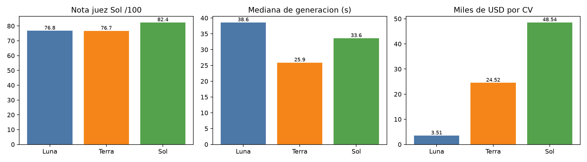
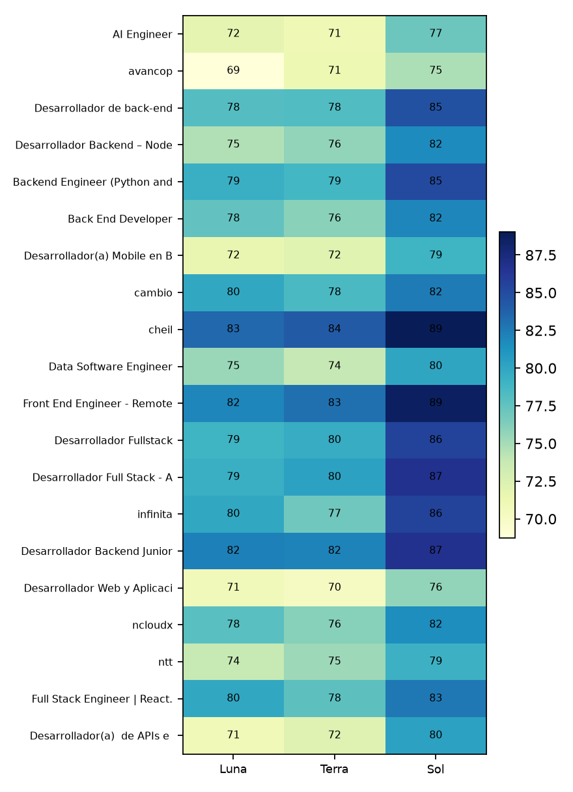
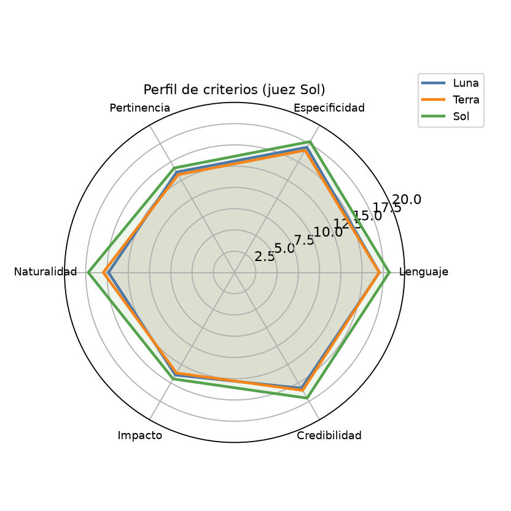
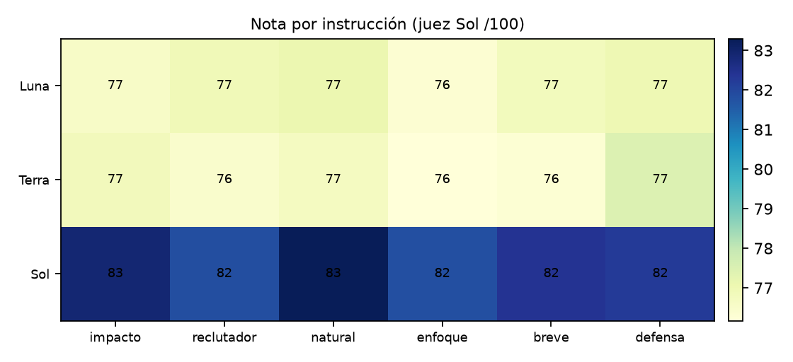
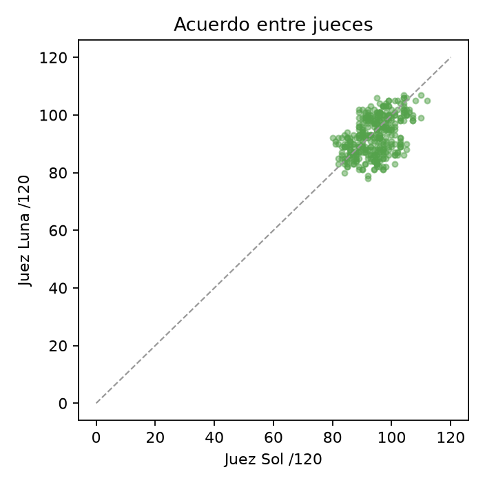

# Benchmark v2: Luna vs Terra vs Sol

20 ofertas reales de LinkedIn × 6 instrucciones de estilo × 3 modelos de OpenAI, con el mismo perfil
sintético marcado «SIMULACION NO ENVIAR», la misma plantilla y el mismo flujo de dos pasadas.
Ningún CV es una postulación ni representa a una persona real.

## Diseño

- 360 condiciones; terminadas e inspeccionables: 360.
- Modelos: Luna, Terra y Sol; todos con service_tier=fast.
- Ofertas: 10 ya usadas en la prueba anterior + 10 nuevas, en español e inglés.
- Instrucciones: impacto, reclutador, natural, enfoque, breve y defensa (defendible en entrevista).
- Evaluación principal: Sol como juez ciego; evaluación secundaria: Luna como segundo juez ciego para medir acuerdo.
- Rúbrica: 6 criterios × 20 puntos = 120; se normaliza a 100. Además se mide una CV duplicada por oferta para estimar consistencia del juez.
- Métricas automáticas: una página, palabras, bullets, bullets cuantificados, aperturas prohibidas, buzzwords, repetición de 4-gramos, cobertura de keywords, campos protegidos y revisión de afirmaciones.

## Resultado global por modelo

| Modelo | PDF | Idioma | 1 página | p50 | p90 | USD / CV | USD / 100 | Sol /100 | Luna /100 |
|---|---|---|---|---|---|---|---|---|---|
| Luna | 120 / 120 | 120 / 120 | 120 / 120 | 38.6 s | 47.9 s | 0.00351 | 0.35 | 76.8 | 76.6 |
| Terra | 120 / 120 | 120 / 120 | 120 / 120 | 25.9 s | 30.6 s | 0.02452 | 2.45 | 76.7 | 76.2 |
| Sol | 120 / 120 | 120 / 120 | 120 / 120 | 33.6 s | 41.0 s | 0.04854 | 4.85 | 82.4 | 79.0 |

## Resultado por idioma de la oferta

| Modelo | ES: casos / nota /120 | EN: casos / nota /120 | ES p50 | EN p50 |
|---|---|---|---|---|
| Luna | 72 / 90.65 | 48 / 94.38 | 39.2 s | 38.2 s |
| Terra | 72 / 91.15 | 48 / 93.23 | 25.9 s | 25.9 s |
| Sol | 72 / 97.82 | 48 / 100.5 | 34.1 s | 32.7 s |

## Criterios del juez Sol (0–20)

| Modelo | Lenguaje | Especificidad | Pertinencia | Naturalidad | Impacto | Credibilidad | Total /120 |
|---|---|---|---|---|---|---|---|
| Luna | 17.03 | 17 | 13.63 | 14.83 | 13.93 | 15.72 | 92.14 |
| Terra | 17.01 | 16.59 | 13.28 | 15.44 | 13.66 | 16.01 | 91.98 |
| Sol | 18.19 | 17.77 | 14.19 | 17.21 | 14.46 | 17.07 | 98.89 |

## Comparación emparejada (juez Sol, misma oferta y prompt)

| Diferencia | Media | Mediana | Gana / Empata / Pierde | Mín / Máx |
|---|---|---|---|---|
| Terra - Luna | -0.16 | +0.0 | 52 / 15 / 53 | -7 / +7 |
| Sol - Luna | +6.75 | +7.0 | 117 / 2 / 1 | -1 / +17 |
| Sol - Terra | +6.91 | +7.0 | 117 / 2 / 1 | -1 / +15 |

## Acuerdo entre jueces

| Métrica | Valor |
|---|---|
| CV evaluados por ambos | 360 |
| Correlación de Pearson | 0.453 |
| Correlación de Spearman | 0.431 |
| Diferencia absoluta media /120 | 5.55 |
| Modelo | Media juez Sol | Media juez Luna |
|---|---|---|
| Luna | 92.14 | 91.88 |
| Terra | 91.98 | 91.42 |
| Sol | 98.89 | 94.78 |

## Consistencia del juez (CV duplicado)

| Modelo | Duplicados | Diferencia absoluta media /120 |
|---|---|---|
| Luna | 5 | 0 |
| Terra | 8 | 0 |
| Sol | 7 | 0 |

## Estilos evaluados por el juez Sol

| Instrucción | Luna | Terra | Sol |
|---|---|---|---|
| impacto | 91.9 | 92.2 | 99.45 |
| reclutador | 92.3 | 91.75 | 98.2 |
| natural | 92.5 | 92.05 | 99.95 |
| enfoque | 91.6 | 91.4 | 98.15 |
| breve | 92.15 | 91.55 | 98.9 |
| defensa | 92.4 | 92.95 | 98.7 |

## Métricas automáticas de calidad

| Modelo | Palabras | Bullets | Palabras/bullet | Cuantificados | Bullet largo | Aperturas prohibidas | Buzz/100 | Repetición 4g | Cobertura | Campos protegidos |
|---|---|---|---|---|---|---|---|---|---|---|
| Luna | 261.86 | 11.53 | 17.61 | 13.03% | 0.76% | 0 | 0.0 | 1.34% | 24.72 | 100.0% |
| Terra | 250.66 | 11.8 | 16.2 | 12.78% | 0.29% | 0 | 0.0 | 1.21% | 26.22 | 100.0% |
| Sol | 274.47 | 12.98 | 17.17 | 18.25% | 0.0% | 0 | 0.0 | 2.19% | 21.26 | 100.0% |

## Idioma, fidelidad y revisión

| Modelo | Idioma | Voz mixta (ES) | No respaldadas | A revisar | Dos pasadas |
|---|---|---|---|---|---|
| Luna | 120 / 120 | 0 / 72 | 0 | 1460 | 120 |
| Terra | 120 / 120 | 0 / 72 | 0 | 1503 | 120 |
| Sol | 120 / 120 | 0 / 72 | 0 | 1545 | 120 |

## Nota del juez Sol por oferta

| Oferta | Luna /100 | Terra /100 | Sol /100 |
|---|---|---|---|
| AI Engineer | 71.8 | 71.0 | 77.1 |
| avancop | 68.8 | 71.2 | 74.7 |
| Desarrollador de back-end | 78.1 | 78.2 | 84.7 |
| Desarrollador Backend – Node.js / NestJS | 74.6 | 75.7 | 81.7 |
| Backend Engineer (Python and SQL) | 79.3 | 78.8 | 85.1 |
| Back End Developer | 77.5 | 76.0 | 81.9 |
| Desarrollador(a) Mobile en Bision Consulti… | 71.5 | 72.1 | 79.0 |
| cambio | 79.9 | 78.5 | 82.5 |
| cheil | 83.5 | 84.2 | 89.0 |
| Data Software Engineer | 75.4 | 73.9 | 80.0 |
| Front End Engineer - Remote | 81.9 | 83.1 | 88.6 |
| Desarrollador Fullstack | 79.0 | 79.6 | 85.6 |
| Desarrollador Full Stack - AWS | 79.3 | 80.3 | 86.7 |
| infinita | 79.9 | 76.9 | 85.6 |
| Desarrollador Backend Junior - Bogotá | 82.2 | 82.1 | 86.7 |
| Desarrollador Web y Aplicaciones Móviles | 70.7 | 70.3 | 75.7 |
| ncloudx | 77.9 | 76.1 | 81.5 |
| ntt | 73.8 | 75.3 | 79.2 |
| Full Stack Engineer \| React.js, TypeScript… | 79.9 | 77.8 | 82.6 |
| Desarrollador(a)  de APIs e Integraciones… | 70.8 | 72.2 | 80.3 |

## Gráficos

## Hallazgos

- Mejor nota del juez Sol: Sol con 82.4/100.
- Más rápido: Terra con mediana 25.9 s; más barato: Luna con USD 0.00351 por CV.
- Sol frente a Luna: +6.75 puntos de 120, gana 117 y pierde 1 de 120 pares.
- Acuerdo entre jueces: Pearson 0.453, Spearman 0.431, diferencia media 5.55 sobre 120.
- Terra frente a Luna: -0.16 puntos de 120, gana 52 y pierde 53 de 120 pares.
- Sol frente a Terra: +6.91 puntos de 120, gana 117 y pierde 1 de 120 pares.
- Mejor instrucción por modelo (juez Sol): Luna: natural (92.5); Terra: defensa (93.0); Sol: natural (100.0).
- Mejor oferta para el perfil sintético: cheil (102.7/120 de media); la más difícil: avancop (85.9/120).
- Diferencia Sol-juez menos Luna-juez por modelo (posible sesgo de familia): Luna +0.3; Terra +0.6; Sol +4.1.
- Consistencia del juez Sol con CV duplicado: diferencia absoluta media 0.0 puntos de 120.
- La nota absoluta no es comparable con la prueba anterior: cambió el conjunto de ofertas, la rúbrica (120 vs 100) y el juez principal.

## Veredicto

- **Calidad:** Sol queda primero con los dos jueces. Con el juez Sol: 82.4 vs 76.8 (Luna) y 76.7 (Terra). Con el juez Luna: 79.0 vs 76.6 (Luna) y 76.2 (Terra). La ventaja es robusta en ranking; la magnitud exacta no lo es.
- **Sesgo del juez:** el juez Sol se asigna +4.1 puntos más de los que le da el juez Luna; a Luna y Terra solo +0.3 y +0.6. Es autopreferencia clara. Aun descontándola, Sol sigue primero (+2.4 con el juez Luna).
- **Luna vs Terra:** empate técnico (−0.16 sobre 120; 52 victorias, 15 empates y 53 derrotas). Terra es 12.7 s más rápido, pero cuesta 7× Luna.
- **Costo absoluto:** Sol ≈ USD 0.049/CV (USD 4.85 por 100), Terra ≈ USD 0.025 (USD 2.45) y Luna ≈ USD 0.0035 (USD 0.35). La diferencia por CV es de centavos.
- **Recomendación:** Sol para CVs de alto interés (mejor calidad y más rápido que Luna); Luna para volumen o si el costo importa; Terra solo si la latencia es crítica.
- **Producción:** el default sigue en Luna Fast; no lo cambié sin confirmación. Pasar a Sol es un cambio de configuración.
- **Mejor instrucción:** natural para Luna y Sol; defensa para Terra. Las diferencias entre estilos son pequeñas y no justifican sobreajustar.
- **Fidelidad y forma:** 0 afirmaciones no respaldadas, 0 aperturas prohibidas, 0 buzzwords, 100% de campos protegidos, 0 voz mixta en los 216 CV en español y 1 página en los 360 CV.

## Límites

Es una simulación con un perfil sintético y un juez automático; no sustituye revisión humana ni predice contratación. Dos jueces de la misma familia reducen, pero no eliminan, el sesgo de evaluación. Las ofertas son reales, pero los CV y las identidades son ficticios.
